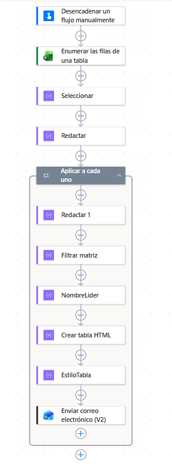
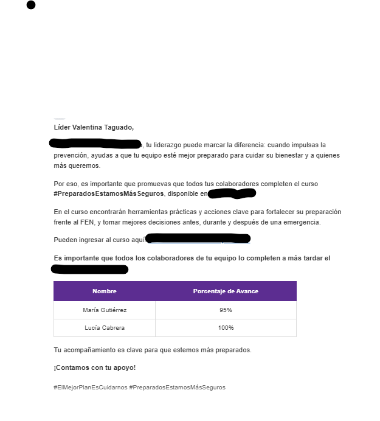

# Envío automatizado de correos por líder (Power Automate)

## Problema
Notificar a cada líder cuáles son las personas a su cargo implicaba armar
y enviar los correos manualmente, un proceso de horas y propenso a errores.

## Solución
Un flujo de Power Automate que lee una tabla de Excel y envía a cada líder
**un único correo** con una tabla HTML de sus colaboradores.

## Cómo funciona
1. Se activa manualmente.
2. Lee las filas de una tabla de Excel (líder, correo, personas a cargo).
3. Agrupa los datos por líder.
4. Por cada líder, filtra sus colaboradores y genera una tabla HTML con estilo.
5. Envía el correo personalizado con Outlook.

## Herramientas
Power Automate, Excel, Outlook, HTML básico

## Resultado
Reduce un proceso manual de horas a minutos y escala a grandes
volúmenes de correos.

## Autora
Angela Vargas Quintero · [LinkedIn](https://www.linkedin.com/in/angela-vargas-databi/)